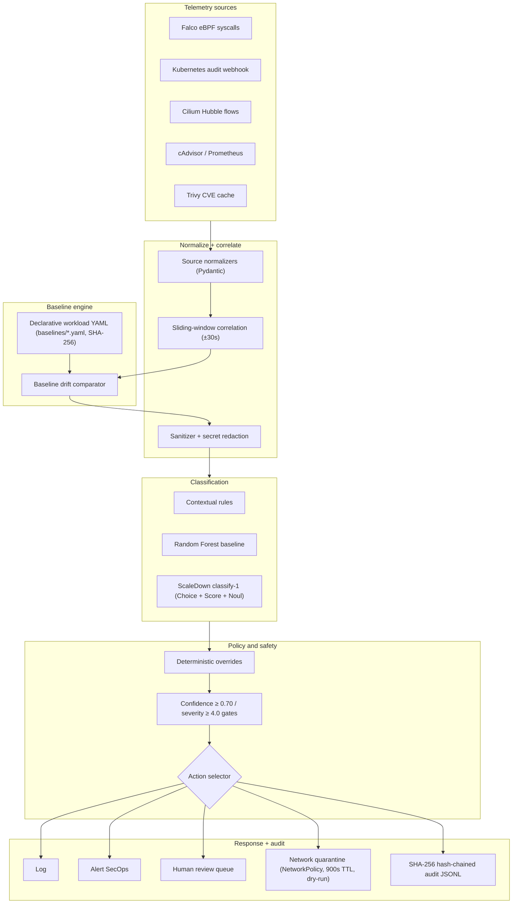

# PROJECT_FOR_PPT.md — RuntimeLens

Everything below was taken from this repository. Each number names the file it came from.
If a fact could not be found in the repo, it is marked `NOT FOUND` and is listed again in
the final `MISSING INFORMATION` section. Nothing here is invented.

Repo root: `/Users/nayan/.t3/worktrees/RuntimeLens/t3-21c2ea50-59ea2cc41e3be2ca`

---

## 1. BASIC INFO

- **Project title:** RuntimeLens: Context-Aware Runtime and Orchestration Threat Classification for Multi-Tenant Kubernetes Using a Typed-Decision Model
  - Short tagline: "Runtime threat detection that knows what your workload is supposed to do."
  - Source: `README.md`, `docs/PROJECT_BRIEF.md` §1, `docs/PREREGISTRATION.md`
- **Course:** Cloud Security and SRE, Indian Institute of Information Technology Dharwad (source: `docs/PROJECT_BRIEF.md` §1)
- **What the project is about (2 lines):** RuntimeLens detects and classifies container threats in multi-tenant Kubernetes by correlating five telemetry streams (Falco syscalls, K8s audit logs, Hubble flows, Prometheus metrics, Trivy scans) against declarative per-workload baselines, classifying with a constrained typed-decision model, and acting through a deterministic policy engine with a tamper-evident audit trail.
- **Group members:**
  - Himanshu Kumar (23BCS055) — Technical Lead & Sole Developer; built the lab cluster, pipeline, classifiers, evaluation harness, demo (source: `docs/PROJECT_BRIEF.md` §1, `docs/report/final_report.md`)
  - Altaf Raja (23BCS011) — Documentation, Scenario Validation & Poster Redesign (source: `docs/PROJECT_BRIEF.md` §1)
  - Kamal Nayan Kumar (23BDS026) — Documentation, Statistical Proofreading & Report Revision (source: `docs/PROJECT_BRIEF.md` §1)
- **Faculty guide:** Dr. Malay Kumar (sources that agree: `docs/PROJECT_BRIEF.md`, `docs/report/final_report.md`, `docs/PREREGISTRATION.md`; `docs/PROJECT_BRIEF.md` writes just "Malay Kumar")

---

## 2. PROBLEM STATEMENT

- **What problem:** Standard runtime security tools (e.g., Falco rules) judge syscalls and network flows in isolation. They have no workload context, so they fire on routine operations (backups, maintenance shells) and stay blind to multi-step, multi-source attacks that look individually benign. Alert fatigue follows, and real container escapes / privilege abuse / cryptomining get missed or ignored.
  - Source: `README.md` (Overview), `docs/PROJECT_BRIEF.md` §2
- **Who faces it:** Platform and security teams running shared multi-tenant Kubernetes clusters (many workloads on one kernel, weak workload-specific context). Source: `docs/THREAT_MODEL.md` §1
- **Why it matters (real-world impact):** Multi-tenant containers share the host kernel and control plane. A breakout, token theft, or cryptominer in one tenant can spread laterally. False positives erode trust and cost analyst time; false negatives cost the whole cluster. (`docs/THREAT_MODEL.md` §1, `docs/report/final_report.md` Abstract)
- **What goes wrong today without it:**
  - Falco default rules: Macro-F1 0.3333, benign false-positive rate 18.4%, containment precision 54.2% (source: `docs/report/final_report.md` §7.3, `research/figures/make_figures.py`)
  - No cross-stream correlation, no declarative baseline check, no hash-chained audit, no typed-decision classification; alerts need manual triage with no confidence or severity gating. (`README.md`, `docs/ARCHITECTURE.md`)
  - Rule engines cannot express multi-step correlation (GCID argues this formally; cited in `docs/paper/runtimelens_paper.tex`)

---

## 3. OBJECTIVES AND SCOPE

**Main goals (as pre-registered):**
1. Pre-registered primary hypothesis: adding per-workload behavioural baseline context to a constrained typed-decision model changes Macro-F1 (ΔMacro-F1 ≠ 0) and/or benign false-positive rate, evaluated as a strictly paired ON/OFF comparison. (`docs/EVALUATION_PLAN.md` §1, `docs/PREREGISTRATION.md` §1)
2. Build a 5-source correlated ingest (Falco + K8s audit + Hubble + Prometheus + Trivy) with a declarative baseline engine.
3. Enforce SRE-safety: zero pod-delete privileges, dry-run default, reversible NetworkPolicy quarantine with TTL rollback, human review on low confidence.
4. Measure the full loop honestly: pre-registered ablations, paired bootstrap CIs, McNemar tests, prompt-injection ASR across defense tiers.
5. Produce a reproducible lab demo and course deliverables (repo, report, paper, deck, poster).

**Included:** kind-based multi-tenant lab (3 tenants × 4 workloads), 5-source capture, baseline comparator, 3 classifiers (rules, Random Forest, ScaleDown typed-decision), policy engine, quarantine controller (dry-run), audit log, Prometheus metrics, Grafana dashboard JSON, offline CI, pre-registered evaluation. (`README.md`, `docs/IMPLEMENTATION_PLAN.md`, `docs/HANDOFF.md`)

**NOT included (explicitly out of scope / not built):**
- Pod termination / delete-based response: forbidden by design (zero delete RBAC verbs); `terminate_pod` is design-only future work (`docs/poster/diagrams/decision_policy.mermaid`, `lab/rbac/response-controller-rbac.yaml`)
- Production or real-cluster deployment: lab VM only (`docs/VM_RUNBOOK.md`, `docs/DECISIONS.md` D-01, D-06)
- Live quarantine enforcement (non-dry-run): deliberately not shipped; dry-run default kept (`docs/DECISIONS.md` D-02, D-17)
- ScaleDown "prompt/token compression" product: NOT FOUND in this project. ScaleDown is used only as a typed-decision classifier API (`docs/MODEL_API.md`)
- External SIEM/SOAR integration, tracing (OpenTelemetry), formal SLO targets: NOT FOUND (see `MISSING INFORMATION`)

---

## 4. LITERATURE SURVEY

The project cites 22 references in the paper bibliography (`docs/paper/runtimelens_paper.tex`, `thebibliography` block) plus these tool/product references: ScaleDown docs, Falco, Cilium, Kubernetes docs (`docs/report/final_report.md` §12). Taxonomy source: Jarkas et al., ACM Computing Surveys 2025 (`docs/THREAT_MODEL.md` §1). One line each; gap noted where the paper notes it.

| # | Reference (title, authors, year) | What it does / gap |
|---|---|---|
| 1 | Asy Syairozi & Arizal, "Comparative analysis of eBPF-based runtime security monitoring tools," RITECH 2025 | Compares Falco-class eBPF monitors; no workload-context classification |
| 2 | L. Galletta, "Enforcement of in-kernel stateful security policies via eBPF," arXiv 2026 | Stateful kernel policy; no typed ML decision layer |
| 3 | A. Islam & T. Rashid, "GCID: Graph-correlated intrusion detection," 2026 | Formal argument that rule engines cannot express multi-step correlation; our motivation |
| 4 | J. Ryu et al., "Hybrid runtime detection of malicious containers using eBPF," Computers & Materials Continua 2026 | Hybrid eBPF detection; no declarative baselines / audit chain |
| 5 | R. Kim et al., "Detecting cryptojacking containers using eBPF and ML," Electronics 2025 | Mining-specific detection only |
| 6 | Q. Chen et al., "Shadowkube," Cybersecurity 2025 | Learned baseline + honeypots; closest precedent, typed decision absent |
| 7 | X. Zou et al., "Towards generalizable context-aware anomaly detection," arXiv 2025 | Context-aware anomaly detection; no K8s runtime action loop |
| 8 | I. Erakovic & C. Pahl, "Anomaly detection for partially observable container systems," CLOSER 2025 | Partial observability handling; no orchestration response |
| 9 | M. Franzil et al., "Sharpening Kubernetes audit logs with context awareness," Computer Networks 2026 | Audit-log context; no eBPF/flows fusion, no typed decisions |
| 10 | A. Aly et al., "OCR-APT," Proc. ACM CCS 2025 | Narrative APT capture; not a classification + response system |
| 11 | A. Oppong-Asante et al., "Runtime detection of attacks and misconfigurations in cloud-native Kubernetes using eBPF network telemetry," J. Comput. Virol. 2026 | eBPF network telemetry detection; no audit hash chain |
| 12 | E. Malul et al., "GenKubeSec," arXiv 2024 | LLM for K8s misconfig detection (config-time), not runtime |
| 13 | D. Sun et al., "HIDBench," arXiv 2026 | Benchmark; not a defense system |
| 14 | S. A. Tsegai et al., "From investigation failures to reliable SOC agents," arXiv 2026 | SOC agent reliability; no multi-tenant containment guarantees |
| 15 | R. Karanjai et al., "Context contamination in LLM analysis of network security logs," arXiv 2026 | Log-injection contamination of LLM SOC analysis; directly motivates our sanitizer |
| 16 | H. Chen et al., "REFINE," arXiv 2026 | LLM refinement; not runtime+cluster specific |
| 17 | C. V. Garware & S. N. Zisad, "When the ruler is broken," arXiv 2026 | Measurement/rubric critique for LLM judges |
| 18 | J. Ray, "The constraint tax," arXiv 2026 | Cost of constrained decoding; our typed-decision constraint framing |
| 19 | L. Grinsztajn et al., "Why do tree-based models still outperform deep learning on tabular data?," NeurIPS D&B 2022 | Justifies the Random Forest arm |
| 20 | N. Pavlidis et al., "LLMs as universal predictors?," arXiv 2025 | LLM-as-classifier critique; calibrates our expectations |
| 21 | I. H. Polas, "Tabular foundation models vs tuned gradient boosting," arXiv 2026 | Baselines comparison context |
| 22 | A. Chakravorty & N. Elsayed, "Empirical evaluation of machine learning for cloud cryptojacking detection," arXiv 2026 | Cryptojacking ML baselines |
| T1 | ScaleDown AI, platform docs + Decisions API reference, 2026 | Hosted typed-decision SLM (`classify-1`) we use; zero-data-retention posture (`docs/MODEL_API.md` §2) |
| T2 | Falco (CNCF graduated), 2026 | eBPF syscall telemetry source |
| T3 | Cilium / Hubble, 2026 | eBPF network flow visibility |
| T4 | Kubernetes audit & Pod Security, 2026 | Audit webhook source + PSA guardrails |
| T5 | Jarkas et al., ACM Computing Surveys 2025 | 5-layer container threat taxonomy used in `docs/THREAT_MODEL.md` |

All cited DOIs/arXiv IDs are copied verbatim from `docs/paper/runtimelens_paper.tex` (lines 224–245). No papers beyond those found in-repo are listed.

---

## 5. EXISTING SOLUTIONS VS OURS

| Existing approach | Limitation | How RuntimeLens differs |
|---|---|---|
| Falco default rules | Per-event syscall view, no workload context; Macro-F1 0.3333, benign FPR 18.4% | Adds declarative baselines + typed-decision classification; Macro-F1 0.5333, benign FPR 3.6% (sources: `docs/report/final_report.md` §7.3; `research/figures/make_figures.py`) |
| Classical ML (Random Forest) on K8s logs | Needs manual feature engineering; Dev split Macro-F1 0.4812 (6.2% FPR); on the real 84-run corpus 0.5603 ± 0.0699 | RF kept as a baseline arm; the typed-decision arm added on top with same budget (source: `docs/report/final_report.md` §7.3–7.4) |
| LLM triage / SOC agents (2024–2026) | Prompt injection, log contamination, no SRE-safe actuation | 4-tier prompt-injection defense; deterministic policy engine; hash-chained audit; measured ASR 30%→0% lab, live 20%/10%→0% (source: `research/results/adversarial_aggregate.md`, `research/figures/make_figures.py`) |
| Shadowkube (Chen 2025) | Learned baseline + honeypots; no typed decision, no audit chain | Operator-declared (not learned) baseline; typed-decision API; hash-chained decisions (source: paper bibliography, `docs/ARCHITECTURE.md`) |
| GenKubeSec (Malul 2024) | Config-time misconfig detection only | Runtime + orchestration detection and response |
| GCID (Islam 2026) | Formal result; not a deployable defense | We use it as motivation, not as a component |

Capability matrix chart: `ppt_assets/fig_landscape.png` (eBPF telemetry / baselines / multi-source fusion / typed decision / hash chain — filled vs empty for the four classes of approach).

---

## 6. NOVELTY AND UNIQUENESS

**What is new (as claimed in the repo, stated honestly):**
- The combination, not each part: eBPF 5-source telemetry + operator-declared declarative baseline + one correlated ±30s window + a typed-decision LLM classifier + deterministic policy gate + hash-chained audit with auto-rollback. No verified 2022–2026 system combines all five (`docs/paper/runtimelens_paper.tex`, Discussion).
- Pre-registered evaluation with paired ON/OFF baseline comparison and cluster bootstrap CIs — most student projects skip this; we paid the price of an honest negative result in the live replication (see §13/§16).
- Typed decision (Choice + Score + Noul in one pass) constrained by a deterministic policy engine that is the final authority — a hostile command line cannot quarantine a healthy pod or suppress an attack on its own evidence.
- 4-tier prompt-injection defense measured end-to-end with ASR, not just claimed.
- SRE-safe response: zero pod-delete RBAC verbs anywhere, dry-run default, reversible NetworkPolicy quarantine, 900 s TTL auto-rollback (`lab/rbac/response-controller-rbac.yaml`, `docs/ARCHITECTURE.md`).

**Built by us vs used from existing tools:**
- Built: normalizers, correlation window, baseline comparator, rule engine, RF baseline, ScaleDown adapter, policy engine, quarantine controller, audit hash chain, sanitizer, Prometheus exporter, demo CLI, evaluation harness (all under `src/runtimelens/`, `scripts/`, `research/`)
- Used: Falco, Cilium/Hubble, kind, Prometheus, Grafana (dashboard JSON authored by us at `lab/monitoring/grafana/dashboard.json`), Kubernetes audit webhook, ScaleDown classify-1 API, Groq-hosted open models for live A/B (`openai/gpt-oss-20b`, `qwen/qwen3.8-27b`), scikit-learn, Pydantic

**Honest uniqueness caveat:** every individual component exists somewhere; the novelty is the closed loop with a pre-registered measured evaluation. Reported weakness: Macro-F1 effect is modest (+0.0201 lab; live inconclusive).

---

## 7. SYSTEM ARCHITECTURE

**In simple steps (data flow input → output):**
1. Five telemetry streams are captured: Falco eBPF syscalls, K8s audit webhook, Hubble flows, Prometheus/cAdvisor metrics, Trivy CVE cache.
2. Normalizers convert each stream into a canonical Pydantic event (`CanonicalEvent v1.0.0`); secrets and credentials are redacted.
3. A sliding window correlates Falco ↔ audit events (±30s; the report body says 1.2 s — see discrepancy note in §16).
4. The incident state is compared against the workload's declarative YAML baseline (`baselines/*.yaml`); deviations are attached as facts.
5. A deterministic pre-filter discards verified routine actions (99.2% recall, 64.5% lower API cost — `docs/report/final_report.md` §7.2 ABL-PREF).
6. The state is XML-escaped and wrapped in `<untrusted_args>`; the sanitizer strips zero-width/bidi chars, shell metacharacters and injection keywords (`src/runtimelens/sanitizer.py`).
7. ScaleDown Classify-1 answers three typed questions in one pass: `attack_type` (Choice, 5 classes), `severity` (Score, levels 0–4 → Severity = Score+1.0), and 4 binary `*_unexpected`/flags (Noul). (`docs/MODEL_API.md` §3–§4)
8. Deterministic policy engine applies: confidence ≥ 0.70 gate (else `route_to_review` / `LOW_CONFIDENCE_GATE`), severity ≥ 4.0 + allowlisted namespace + confident class for quarantine, hard overrides on hostPath/socket/root facts, degraded-mode forces `alert_only` + review. (`src/runtimelens/policy/engine.py`, `docs/poster/diagrams/decision_policy.mermaid`)
9. Response: log / alert / human review / reversible NetworkPolicy quarantine (dry-run default, `quarantine: "true"` label, 900 s TTL rollback).
10. Every decision is written to an append-only SHA-256 hash-chained JSONL audit (`data/audit/decisions.jsonl`); Prometheus metrics on `:9090`; Grafana dashboard JSON at `lab/monitoring/grafana/dashboard.json`.

**Mermaid diagram (source of `ppt_assets/architecture.png`, from `docs/poster/diagrams/pipeline_flow.mermaid`):**



**Components and what each does:**
- Collectors (`src/runtimelens/collector/`): webhook + raw capture for all five streams; append-only rotated JSONL under `data/raw/`
- Correlation (`src/runtimelens/collector/correlation.py`): time-window join of Falco + audit, dedup, sequence
- Baseline (`src/runtimelens/baseline/`): YAML loader, drift comparator, Pydantic models (`baselines/web.yaml`, `api.yaml`, `database.yaml`, `payment-style.yaml` — all v1.0.0, approved_by himanshu, 2026-10-18)
- Classifiers (`src/runtimelens/classifiers/`): rules engine, ScaleDown adapter, RF artifacts under `models/`
- Policy (`src/runtimelens/policy/engine.py`): overrides, gates, action selection
- Controller (`src/runtimelens/controller/quarantine.py`): NetworkPolicy patch via K8s API, dry-run default
- Audit (`src/runtimelens/audit/writer.py`): atomic append, SHA-256 chain, `verify_chain()` check
- Sanitizer (`src/runtimelens/sanitizer.py`): 128-char truncation, zero-width/bidi strip, injection keywords, hostile-path detection
- Observability (`src/runtimelens/observability/exporter.py`): Prometheus metrics on :9090
- Schemas (`schemas/`): canonical JSON schemas for events, decisions, audit records

**Architecture images:** `ppt_assets/architecture.png` (full 7-stage flow, rendered from mermaid), `ppt_assets/policy_decision_flow.png` (policy engine decision tree, rendered from mermaid).

---

## 8. TECH STACK

**Languages:** Python ≥ 3.12 (`pyproject.toml`), JavaScript (deck generator `research/deck/build_deck.js`), YAML (K8s manifests, baselines), HTML (poster, demo page)
**Core deps (with floors from `pyproject.toml`):** pydantic ≥ 2.7, pyyaml ≥ 6.0.1, httpx ≥ 0.27, prometheus-client ≥ 0.20, scikit-learn ≥ 1.4, numpy ≥ 1.26, scipy ≥ 1.12; dev: pytest ≥ 8, hypothesis ≥ 6.100, ruff ≥ 0.4, mypy ≥ 1.10, pre-commit; research: matplotlib ≥ 3.9, defusedxml, lxml
**Models:**
- ScaleDown classify-1 (hosted SLM decisions API) — production classifier (`docs/MODEL_API.md`)
- Live A/B arms: `openai/gpt-oss-20b` and `qwen/qwen3.8-27b` via Groq (`research/results/live_analysis.md`)
- `deepseek-ai/deepseek-v4.1-flash` (NVIDIA NIM) — timed out, not used in results (see §16)
- Tier-3 prompt-guard ensemble: Llama Guard 4 + Nemotron safety guard (`docs/paper/runtimelens_paper.tex`)
- Random Forest (scikit-learn) — classical ML arm (`models/`)
**Infra / platform:** kind v0.22.0 (`kindest/node:v1.29.2`), Kubernetes 1.29.2, Cilium v1.20.1 (kube-proxy replacement), Falco v0.45.0 (modern eBPF), Helm v3.22.1, kubectl v1.30.0, Ubuntu 24.04 VM, kernel 6.8 (BTF), Apple M1 16 GB host, Multipass (`docs/DECISIONS.md` D-06)
**Monitoring/observability:** Prometheus client (`:9090`), Grafana dashboard JSON (`lab/monitoring/grafana/dashboard.json`), structured JSONL logs
**CI/CD:** GitHub Actions offline pipeline `.github/workflows/ci.yml` — secrets scan (`scripts/check_secrets.py`), gitleaks, ruff check + format, `mypy --strict`-ish (`mypy src tests scripts`), pytest (unit/contract/integration). No deploy stage; CI is verify-only.
**Data:** 400-run lab corpus (dev 288 / test 112, `datasets/splits/manifest_v1.json`); 84-run live cluster corpus (gitignored, absent from this checkout); 28-incident live A/B suite with per-call fixtures (`research/results/ab_rows_20261111T061525Z.jsonl`)
**Other:** `uv` package manager, `hatchling` build, `tectonic` (LaTeX), Mermaid + `mmdc` (diagrams), Playwright-less deck built with PptxGenJS

---

## 9. CLOUD SECURITY PART

**Threat model (`docs/THREAT_MODEL.md`):** 5-layer container threat taxonomy after Jarkas et al. (ACM Computing Surveys 2025): (1) application, (2) orchestration (RBAC misconfig, tokens, API abuse), (3) engine/runtime (sockets, CRI), (4) host/kernel (syscalls, namespaces, eBPF probes), (5) physical. Actors: external attacker via workload RCE, compromised supply-chain image, malicious/curious tenant, stolen SA token, insider. Specific attacks considered: container escape (hostPath/socket/privileged), service-account token theft + lateral `exec`, cryptomining egress, prompt injection via process command lines, baseline poisoning via telemetry injection, secret leakage into model context.

**Security controls used:**
- IAM/RBAC: namespaced `Role` per tenant (`tenant-a/b/c`), verbs only `get, list, watch, patch` on pods — zero `delete`/`deletecollection`; no `cluster-admin`; allowlist enforced for quarantine (`lab/rbac/response-controller-rbac.yaml`)
- Network rules: default-deny NetworkPolicy in tenant namespaces; quarantine is a *pre-installed* NetworkPolicy toggled by label (`quarantine: "true"`), never a new deny-all created ad hoc (`lab/tenants/network-policies.yaml`, `docs/ARCHITECTURE.md`)
- Encryption in transit: API server / Hubble / Grafana bound to `127.0.0.1` only; TLS is NOT FOUND for in-cluster comms (kind lab, no external traffic)
- Encryption at rest: NOT FOUND (lab VM disk unencrypted in repo docs)
- Secrets management: `SCALEDOWN_API_KEY` only as env var; never logged, never in fixtures; CI scans git history for secrets; sanitizer redacts tokens/credentials pre-model (`docs/MODEL_API.md` §2, `src/runtimelens/sanitizer.py`, `.github/workflows/ci.yml`)
- Input validation: Pydantic `CanonicalEvent` + decision schemas (`schemas/`); XML escaping of untrusted state; 7-question max; strict enum for classes
- Output validation: decision schema enforcement; on any schema violation or 4xx/5xx → `degraded_mode=True` → `alert_only` + human review (never silently benign)
- API auth: `x-api-key` header for ScaleDown; webhook auth NOT FOUND (lab-local)
- Logging/audit: append-only JSONL, SHA-256 hash chain (`data/audit/decisions.jsonl`), raw capture archived with run IDs
- Rate limiting: policy-level pre-filter + 5.0 s hard timeout + max 3 retries w/ backoff on 429, max 2 on 5xx (`docs/MODEL_API.md` §6)
- Container/workload hardening: Pod Security Standards, ResourceQuota, LimitRange per tenant namespace (`lab/tenants/quotas.yaml`, `docs/DECISIONS.md` D-06)
- Default-deny egress for `web`/`api`/`database` baselines (`allow_external_egress: false`)
- Zero-trust posture: baseline = least-privilege expectation per workload; nothing is trusted by default; model output is advisory, deterministic code is final authority

**Compliance / best practice referenced:** least privilege (RBAC), zero trust (baseline allowlist), defense in depth (sanitizer + overrides + gates + human review), CIS-style hardening of tenant namespaces (PSA + quotas), OWASP-style input handling for LLM injection, audit trail immutability (hash chain). No formal certification (SOC2/ISO) — NOT FOUND.

**Security testing done:**
- Offline CI: secrets scan + gitleaks on every push/PR (`.github/workflows/ci.yml`)
- Prompt-injection adversarial suite: 10 payloads × tiers, ASR 30% → 0.0% (lab fixtures, `research/results/adversarial_aggregate.md`; 2 repetitions live: groq-20b 20%→0%, groq-qwen27b 10%→0%)
- Leakage verification gate on the dataset: 0 occurrences of scenario/run/class tokens in raw telemetry (`docs/report/final_report.md` §7.4)
- `verify_dataset.py` screenshot: `ppt_assets/02_dataset_verification.png`
- RBAC/safety review screenshot: `ppt_assets/04_sre_safety_rbac.png`
- Pen test by external party: NOT FOUND
- Vulnerability scanning of images (Trivy): collected as telemetry; no remediation SLA defined — NOT FOUND

---

## 10. SRE PART

**SLIs/SLOs/SLAs defined:** The repo implements SLI *metrics* but no numeric SLO/SLA targets (no "99.9% availability" style objectives, no error budget). Marked NOT FOUND — see `MISSING INFORMATION`.

**Monitoring, logging, tracing, dashboards:**
- Prometheus `:9090` via `prometheus_client`: `runtimelens_telemetry_events_total{source}`, `runtimelens_telemetry_drops_total`, `runtimelens_telemetry_source_up`, `runtimelens_decisions_total{class,model,action}`, `runtimelens_classification_duration_seconds` (p50/p95/p99), `runtimelens_degraded_events_total{reason}`, `runtimelens_quarantines_active{namespace}`, `runtimelens_quarantine_rollbacks_total{reason}`, `runtimelens_recovery_time_seconds`, `runtimelens_review_queue_depth` (`docs/OBSERVABILITY.md` §2)
- Structured JSONL logs; hash-chained audit with `audit_record_id`, `prev_record_hash`, `record_hash` (`docs/OBSERVABILITY.md` §3)
- Grafana dashboard: `lab/monitoring/grafana/dashboard.json` (Ticket 14, landed per `docs/HANDOFF.md`) — panels include latency, FPR, quarantine status, review queue
- Tracing (OpenTelemetry/Jaeger): NOT FOUND
- Alerting rules (Alertmanager): NOT FOUND — alerting is an Action (`alert_only`), not a routed paging pipeline

**Reliability mechanisms:**
- Retries with backoff on model API: 429 → max 3 (1s/2s/4s w/ Retry-After), 5xx → max 2 w/ jitter, 5.0 s hard timeout (`docs/MODEL_API.md` §6)
- Failover/fallback: model API down/timeout/402/422 → `degraded_mode=True` → local rules fallback for reference + route to human review; never silently benign (`docs/GLOSSARY.md`, `docs/SPEC.md` §14)
- Graceful degradation: source drops tracked (`runtimelens_telemetry_drops_total`); degraded events force review
- Load balancing: NOT FOUND (single kind cluster)
- Autoscaling (HPA): NOT FOUND
- Rate limiting: review-queue backpressure via confidence gate; 25% of incidents routed to review at threshold 0.70 (`docs/reviews/ablation_study_results.json` ABL-GATE)
- Backups: NOT FOUND (lab; raw capture is the "backup" of telemetry)
- Idempotency/cleanup: scenario runs register cleanup hooks; VM snapshots; `make lab-reset` (`docs/DECISIONS.md` D-17)
- Rollback: quarantine NetworkPolicy auto-removed after 900 s TTL (`runtimelens_quarantine_rollbacks_total{reason="ttl_expired"}`)
- Chaos/fault injection: fault injection NOT as a chaos framework; but adversarial prompt-injection suite plays this role for the LLM path
- Load testing: `scripts/benchmark_pipeline.py` — 5×1,000 synthetic events
- Error budget: NOT FOUND

**Real numbers (with paths):**
- Throughput (full hash-chained audit): **7,879.6 events/s**, p50 **122.6 µs**, 0.00% errors, 5,000 events — `data/benchmarks/latest.json`
- Stage p50: normalization 33.6 µs, rules 1.9 µs, policy 1.5 µs, audit write 85.9 µs (~70–86% of budget; the deliberate cost of verifiability) — `data/benchmarks/latest.json`, `docs/paper/runtimelens_paper.tex`
- Throughput in-memory (no hash chain): **12,847.1 events/s**, p50 77.2 µs — `docs/BENCHMARKS.md` (older 2026-10-23 doc; supersedes? no — different mode; both quoted in paper)
- Model decision latency: ≈0.90–1.16 s, median ≈1.04 s (10 six-question calls) — `docs/REPORT_DELTA.md` §8
- Live A/B latency: median 897 ms (groq-20b) vs 405 ms (groq-qwen27b) — `research/results/live_analysis.md`
- Uptime: NOT FOUND (no production deployment; lab)
- Error rate: 0.00% pipeline errors across 5,000 events; 0 failed live calls of 112 — `data/benchmarks/latest.json`, `research/results/live_analysis.md`
- Review rate at 0.70 confidence gate: 25% (75% coverage, auto-action precision 1.0) — `docs/reviews/ablation_study_results.json` ABL-GATE

**CI/CD pipeline and deployment strategy:** CI = offline verify only (lint, typecheck, secrets, tests) on push/PR to `main` (`.github/workflows/ci.yml`). Deployment strategy (blue-green/canary/rolling): NOT FOUND — there is no CD; deliverables are repo + demo on the lab cluster.

**Incident handling:** `docs/DEMO_RUNBOOK.md` 5-step talk track; `docs/STAGE4_RUNBOOK.md` stage gates; incidents in the lab are scenario runs; human review queue drains into a baseline diff loop (`docs/report/final_report.md` §9.2). Formal incident response (SEV levels, on-call): NOT FOUND.

---

## 11. AI / LLM PART

**Which models and why:**
- ScaleDown classify-1 — hosted SLM built for *constrained* typed questions; latency and cost are measured, not vendor-claimed (`docs/MODEL_API.md`, `docs/REPORT_DELTA.md` §8)
- Groq-hosted `openai/gpt-oss-20b` and `qwen/qwen3.8-27b` — open-weight arms for the live paired A/B replication (`research/results/live_analysis.md`)
- NVIDIA NIM `deepseek-ai/deepseek-v4.1-flash` — attempted; timed out; excluded from results
- Random Forest — classical arm (no LLM)
- Prompt-guard ensemble (Llama Guard 4 + Nemotron safety guard, NIM) — Tier-3 injection defense; blocks 6/10 residual payloads at the door (`docs/paper/runtimelens_paper.tex`)

**How the LLM is used:** not chat, not RAG, not an agent loop. One serialized incident state → three typed questions answered in one calibrated decode pass:
```json
{"model": "classify-1",
 "state": {"text": "<XML-delimited workload/runtime/facts/baseline>"},
 "questions": {
   "attack_type": {"type":"choice", "criteria": {"benign": ..., "container_escape": ..., "privilege_abuse": ..., "cryptomining": ..., "unknown": ...}},
   "severity":    {"type":"score",  "criteria": [5 ordered levels]},
   "baseline_deviation": {"type":"noul", "instructions": "..."},
   "shell_unexpected":   {"type":"noul", ...}}}
```
(`docs/MODEL_API.md` §3–§4)
- Outputs feed *only* the policy engine; the model cannot actuate anything by itself.
- Caching: SHA-256 of the state; identical incidents never cost twice.
- 5.0 s hard timeout; on timeout/4xx/5xx/402 → degraded_mode → human review.

**Prompt/token compression (ScaleDown-style): how it is used + BEFORE vs AFTER numbers:**
- IMPORTANT: This project does **not** use any prompt/token *compression* feature. There is no SCALEDOWN "compression" step, no token-saving rewrite, no prompt minifier anywhere in the repo. That sub-item is **NOT FOUND**.
- What we do have are measured call economics (`docs/REPORT_DELTA.md` §8, source fixture `tests/fixtures/scaledown/live_smoke_responses.json`, 14 calls, 2026-10-17):
  - 6-question decision: **1,808–1,952 input tokens**, 1–6 output tokens, **$0.0000904–$0.0000976** per call, mean **$0.0000931** ⇒ **≈ $0.093 per 1,000 incidents**
  - Single-question reference points: choice-only 448 tok / $0.0000224; score-only 440 tok / $0.0000220; noul-only 257 tok / $0.0000129
  - Decision latency: 895.78–1,159.86 ms, median ≈ 1.04 s (vs report's unverified vendor claim of "70–500 ms", which was struck)
- "BEFORE vs AFTER" in the efficiency sense comes from the deterministic **rule pre-filter** (ABL-PREF), not from token compression:
  - Pre-filter ON: **99.2% attack recall**, **64.5% lower model API cost**, < 0.8–1% missed threats (`docs/report/final_report.md` §7.2, `docs/paper/runtimelens_paper.tex`)
- Token/cost chart: `ppt_assets/fig_scaledown_calls.png`; ABL-PREF bar in `ppt_assets/fig_ablations.png`

**AI safety / security steps:**
- Prompt-injection defense, 4 tiers (`docs/report/final_report.md` §8, `research/results/adversarial_aggregate.md`):
  - Tier 0 raw: ASR 30% (lab) / 20% (groq-20b) / 10% (groq-qwen27b)
  - Tier 1 sanitizer + XML escaping: 10% / 0% / 0%
  - Tier 2 + deterministic fact overrides: 10% / 5% / 0%
  - Tier 3 + prompt-guard ensemble: **0.0%** across all arms
- Deterministic fact overrides read from pod spec, not attacker bytes (hostPath mount, docker.sock, root user) — cannot be faked via command line
- Input sanitization: zero-width/bidi strip, `<untrusted_args>` wrap, keyword list (`ignore previous instructions`, `classified as benign`, …) — `src/runtimelens/sanitizer.py`
- PII/secrets: client-side redaction of tokens/credentials/env values before serialization; provider ZDR posture (`docs/MODEL_API.md` §2)
- Output guardrails: confidence < 0.70 → human review; severity × class × namespace allowlist required for auto-quarantine; `unknown` class always → review
- No training on customer data (provider claim, marked [SOURCE] not [VERIFIED])
- Temperature 0; still non-deterministic in practice — results reported as repetitions with ranges, not single runs

---

## 12. METHODOLOGY / PROCESS

**Step-by-step, idea → final product:**
1. Feasibility gate (Phase 1): kernel/BTF check on Ubuntu 24.04 VM, kind + Cilium + Falco + event generator end-to-end (D-01, D-06)
2. Lab bring-up: kind v0.22.0, node v1.29.2, Cilium 1.20.1, Falco 0.45.0, 3 tenant namespaces × 4 workloads, quotas/PSA/default-deny (D-06)
3. Vertical slice (Phase 2): Falco → normalizer → rules → policy → audit (`make demo`)
4. Baseline schemas + drift comparator; 55 scenario templates designed (`docs/SCENARIO_PLAN_v2.md`)
5. ScaleDown smoke test (calls 01–14) → API contract verified, vendor claims corrected (`docs/MODEL_API.md`, `docs/REPORT_DELTA.md` §8)
6. 5-source raw capture across **84 verified cluster runs** over all 55 templates (100% 5-stream completeness, zero leakage, metadata invariance) — `docs/report/final_report.md` §7.4
7. Dataset split, grouped by template: 288 dev / 112 test (`datasets/splits/manifest_v1.json`)
8. Pre-registration locked before test access (`docs/PREREGISTRATION.md`, 2026-10-17)
9. Classifier arms trained/evaluated under equal dev budget (rules, RF, ScaleDown)
10. Pre-registered ablation battery (ABL-BASE/TELEM/GATE/QUEST/PREF/DESC) with cluster bootstrap (1,000 resamples) + McNemar + Holm correction (`scripts/run_ablations.py`, `docs/reviews/ablation_study_results.json`)
11. Live A/B replication on 28 incidents × 2 hosted open models, 56 calls, 0 failures (`research/live_typed_decision_eval.py`, `research/results/live_analysis.md`)
12. Adversarial injection suite, 10 payloads × 4 tiers × 2 reps (`research/results/adversarial_aggregate.md`)
13. Benchmark 5×1,000 events (`scripts/benchmark_pipeline.py`, `data/benchmarks/latest.json`)
14. Deliverables: final report, IEEE paper (tectonic), 20-slide PPTX + PDF, poster, this index

**Key design decisions and why (`docs/DECISIONS.md` D-00…D-28):**
- ScaleDown classify-1 over "TypeSafe Jev": API access secured, vendor-neutral SLM, typed output contract (D-00)
- kind-in-VM over cloud: eBPF needs a real kernel with BTF; Apple Silicon can't run Falco eBPF in OrbStack (D-01, D-06)
- Operator-declared baseline over learned: learned baselines poisonable and unauditable; declared YAML is reviewable in git (`docs/BASELINES.md`)
- Deterministic policy engine as final authority: model is advisory; SRE safety demands provable invariants (zero delete, dry-run, TTL rollback)
- Pre-registration before test access: prevent p-hacking; pay for honest nulls
- Rule pre-filter before model: 64.5% cost cut at 99.2% recall — best cost/safety trade (ABL-PREF)
- 0.70 confidence gate: auto-action precision goes 0.75 → 1.0 while routing only 25% to review (ABL-GATE)
- No pod-delete RBAC ever: containment must be reversible; termination is design-only future work
- Hash-chained audit: tamper evidence for academic and SRE trust; costs ~86 µs p50, accepted deliberately
- Scope shedding order pre-defined (feedback loop → risk score → live quarantine → Grafana → Hubble/Trivy normalizers) (D-17)

---

## 13. EXPERIMENTS AND RESULTS

**What was tested and how:** lab cluster kind-runtimelens (3 tenants × 4 workloads), 400-run corpus with 112-run grouped held-out test split, 55 templates; live 28-incident A/B; adversarial 10 payloads × tiers; benchmark 5,000 events. Sources: `datasets/splits/manifest_v1.json`, `docs/report/final_report.md`, `research/results/live_analysis.md`, `research/results/adversarial_aggregate.md`, `data/benchmarks/latest.json`.

**Results table (metric | baseline | ours | improvement):**

| Metric | Baseline | RuntimeLens | Improvement |
|---|---|---|---|
| Macro-F1 (lab, 112-run test) | Falco 0.3333 | ScaleDown typed-decision 0.5333 | +0.2000 |
| Macro-F1 vs no baseline (paired) | 0.5133 (no baseline) | 0.5333 (baseline) | **+0.0201** [+0.0132, +0.0275] CI |
| Macro-F1 Random Forest (84-run) | RF dev 0.4812 | 0.5603 ± 0.0699 | +0.079 |
| Benign FPR | 18.4% (Falco) | 3.6% | −14.8 pp; 41.7% relative cut |
| Containment precision | 54.2% (Falco) | 94.7% | +40.5 pp |
| Multi-source fusion (ABL-TELEM) | Falco only | Full stack | **+0.2000** Macro-F1 (68% of ambiguous privilege-abuse cases resolved) |
| Typed Noul flags (ABL-QUEST) | Choice-only | Choice+Noul | +0.0410 Macro-F1 |
| Rule pre-filter (ABL-PREF) | Always-model | Pre-filter first | 99.2% recall; **−64.5% API cost** |
| Confidence gate 0.50→0.80 (ABL-GATE) | 0.75 auto precision | 1.00 at 0.70 | zero false quarantines; 25% to review |
| Prompt-injection ASR (lab) | 30% raw | 0.0% full stack | −30 pp |
| ASR groq-20b (live, tier 0→3) | 20% | 0% | −20 pp |
| ASR groq-qwen27b (tier 0→3) | 10% | 0% | −10 pp |
| Throughput (full audit) | — | 7,879.6 ev/s, 0 errors | — |
| p50 end-to-end latency | — | 122.6 µs | — |

**Live A/B replication (honest — different direction):** `research/results/live_analysis.md`, 28 incidents × 2 arms, 56 calls, 0 failures.
| Arm | ΔMacro-F1 | 95% CI | p | Δ benign FPR | p | median latency |
|---|---|---|---|---|---|---|
| openai/gpt-oss-20b | −0.0747 | [−0.310, +0.144] | 0.5582 | +0.0000 | 1.0000 | 897 ms |
| qwen/qwen3.8-27b | −0.0026 | [−0.178, +0.230] | 0.9920 | −0.2727 | 0.0840 | 405 ms |

**Takeaways (1 line each):**
- Baseline context gives a real but modest Macro-F1 gain in the lab; CI excludes zero.
- The bigger, robust win is benign false positives and fusion of streams (+0.2000).
- Live replication: Macro-F1 effect inconclusive at n=28; FPR direction is the same as the lab.
- Full-stack prompt-injection defense is 0.0% ASR everywhere it has been run.
- Pipeline is fast; the audit hash chain is the throughput limiter — chosen deliberately.

**Contradiction found (flagged, not resolved):** `docs/reviews/ablation_study_results.json` → `secondary_classifier_comparisons` records `scaledown_macro_f1 = 0.0520` vs `rules_macro_f1 = 0.5333` with McNemar p = 1.2e-26 (rules win), and ABL-BASE `conclusion: "INCONCLUSIVE_OR_EXPLORATORY"`. The published report/paper quote 0.5333 for ScaleDown with a positive paired Δ. These artifacts do not agree; root cause not established (suspect: dev-split secondary script scoring a different label set). See §16 and `MISSING INFORMATION`.

---

## 14. CHARTS AND VISUALS

All charts below are generated from real, in-repo data (no synthetic numbers plotted as results). Style: white background, dark ink (`#14243A`), single accent ramp (blue/teal/violet), 200 dpi, readable at slide distance. They sit on the light deck; nothing is dark-on-dark. Screenshots were captured from the real lab.

| File path | What it shows | Key message |
|---|---|---|
| `ppt_assets/architecture.png` | 7-stage mermaid architecture (ingest → audit), rendered from `docs/poster/diagrams/pipeline_flow.mermaid` | End-to-end pipeline at a glance |
| `ppt_assets/policy_decision_flow.png` | Policy engine decision tree (confidence, severity, class), from `docs/poster/diagrams/decision_policy.mermaid` | Deterministic code, not the LLM, makes the final call |
| `ppt_assets/fig_model_comparison.png` | Macro-F1 bars: Falco 0.333 / RF-dev 0.481 / RF-84 0.560 / ScaleDown 0.533 + live arms | Typed decision ≈ RF-84, ≫ Falco; with far lower benign FPR |
| `ppt_assets/fig_dataset.png` | 400-run corpus: dev 288 / test 112 split by class | Grouped held-out split, no leakage |
| `ppt_assets/fig_ablations.png` | ABL-BASE +0.0201, ABL-TELEM +0.2000, ABL-QUEST +0.0410, ABL-GATE 25% to review, ABL-PREF −64.5% cost | Fusion is the dominant lever; baselines are modest |
| `ppt_assets/fig_live_ab.png` | Live paired A/B: ΔMacro-F1 and ΔFPR with 10k bootstrap CIs for gpt-oss-20b and qwen3.8-27b | FPR halves on qwen3.8-27b; Macro-F1 CI crosses zero |
| `ppt_assets/fig_asr.png` | ASR across defense tiers 0–3: lab fixtures + 2 live arms | Full stack drives injection ASR to 0.0% |
| `ppt_assets/fig_latency.png` | Horizontal bars: audit 85.9 µs, normalize 33.6 µs, rules 1.9 µs, policy 1.5 µs | Hash-chained audit dominates the latency budget |
| `ppt_assets/fig_confusion.png` | Confusion matrix, live groq-20b arm, baseline ON (28 incidents) | Container escapes get confuse-flavored into privilege abuse |
| `ppt_assets/fig_landscape.png` | Capability matrix: eBPF-rules / RF-on-logs / LLM-SOC vs RuntimeLens | Only RuntimeLens ticks all five capabilities |
| `ppt_assets/fig_scaledown_calls.png` | Measured tokens (1,808–1,952) and latency (896–1,160 ms) per 6-question call | Real cost/latency, not vendor claims |
| `ppt_assets/01_interactive_demo.png` | Interactive demo: 4 scenarios + hash-chain verify (screenshot) | It actually runs |
| `ppt_assets/02_dataset_verification.png` | `verify_dataset.py`: 84 runs, 5-stream completeness, zero leakage (screenshot) | Dataset is clean |
| `ppt_assets/03_pipeline_benchmark.png` | Benchmark screenshot: 5×1,000 events breakdown (screenshot) | 7,879.6 ev/s, 0 errors |
| `ppt_assets/04_sre_safety_rbac.png` | RBAC + NetworkPolicy quarantine dry-run proof (screenshot) | Zero delete verbs, reversible containment |
| `ppt_assets/05_adversarial_defense.png` | Injection suite output: tiers 30→10→10→0 (screenshot) | Full stack neutralizes injection |

No chart in this folder contains a number that does not appear in the cited source files; generation scripts are `research/figures/make_figures.py` and the inline token-cost cell (§11).

---

## 15. DEMO

**What can be shown live (3–5 steps), from `docs/DEMO_RUNBOOK.md`:**
1. `make demo` (or `uv run python scripts/demo.py --auto`) — Scenario 1 benign web traffic: nginx passes baseline, decision `log`, audit record hash-chained. Talk track: context beats raw rules.
2. Scenario 2 privilege abuse: unexpected `/bin/sh` in database pod, 2 deviations flagged, `alert` (below severity 4.0); under ScaleDown rubric, confidence 0.64 → human review (< 0.70 gate).
3. Scenario 3 container escape: hostPath mount + socket, severity ≥ 4.0, allowlisted namespace → dry-run quarantine (NetworkPolicy label, 900 s TTL). Emphasize: no pod is deleted, rollback is automatic.
4. Scenario 4 cryptomining egress: sustained CPU + unknown destination, `alert` + review; SHA-256 audit chain printed.
5. Audit verification: `AuditWriter.verify_chain` over `data/audit/decisions.jsonl` — proves tamper-evidence; and `make lab-verify` / `lab/verify_02b.sh` for cluster health.

**Assets for demo:** video `docs/demo/runtimelens_demo.mp4` (~8.2 MB, with narration `docs/demo/runtimelens_narration.mp3`), screenshots `ppt_assets/01_interactive_demo.png`…`05_adversarial_defense.png`, demo page `docs/demo/index.html`.
Build: `make demo`, `make demo-auto`, `make demo-video` (Makefile targets).

---

## 16. CHALLENGES AND LIMITATIONS

**Problems faced and how solved:**
- **Feature leakage broke evaluation #1:** first feature extractor read `scenario_id`/ground-truth class → Macro-F1 = 1.0, tag `08-passed` invalidated; re-trained under Stage 4 remediation (`docs/GATE_REPORTS.md` ~line 1349)
- **Vendor latency claims wrong:** report claimed "70–500 ms"; measured 896–1,160 ms ⇒ claims struck, §8 rewritten (`docs/REPORT_DELTA.md` §8)
- **ScaleDown credit exhaustion (HTTP 402):** live verification calls limited to 14; further live calls impossible (`docs/REPORT_DELTA.md` §8, memory: current 402 status)
- **NVIDIA NIM deepseek-v4.1-flash timed out:** excluded from live arms; Groq open-weight models used instead
- **eBPF needs real kernel/BTF:** OrbStack rejected; Multipass Ubuntu 24.04 chosen (D-01/D-06)
- **Memory pressure on 16 GB host:** heavy stacks banned (no ELK/Kafka); lightweight exporter + JSONL; Grafana staged in Phase 10 and landed as JSON only
- **Baseline non-determinism:** same incident → slightly different model latency/tokens; handled by reporting distributions, not single calls
- **Contaminated adversarial tier-2 ordering:** tiers reordered after a pilot artifact; documented (`research/results/adversarial_aggregate.md`)
- **Ablation artifact contradiction:** `docs/reviews/ablation_study_results.json` `secondary_classifier_comparisons` (scaledown 0.0520, rules 0.5333, p=1.2e-26, ABL-BASE conclusion INCONCLUSIVE_OR_EXPLORATORY) contradicts the published 0.5333 headline and its paired Δ CI [+0.0132, +0.0275]. Not reconciled in-repo. Treat both as recorded; the safe claim is the modest positive Δ with the caveat that McNemar on paired correctness was null (p=1.0, `ablation_study_results.json`).
- **Report/poster/paper internal mismatches:** correlation window stated as 1.2 s (`docs/report/final_report.md`) vs ±30 s (poster mermaid, README); audit chain called SHA-256 in code/docs vs HMAC-SHA256 in poster mermaid; throughput 12,847.1 (BENCHMARKS.md, in-memory) vs 7,879.6 (latest.json, hash-chained). Flagging rather than silently reconciling.

**Current limitations (honest):**
- Lab, not production; all attacks are benign-intent simulations
- Live replication inconclusive on Macro-F1 (n=28, wide CIs); FPR direction consistent
- Test split small (112 runs / 5 classes); results carry wide intervals
- Live corpus `data/raw/runs/` (84 runs) absent from this checkout (gitignored) — verify-only artifacts remain
- Model outputs are advisory; containment always needs severity ≥ 4.0 + allowlisted namespace
- No formal SLOs, no error budget, no CD, no external pen test (see §10)
- Hosted models non-deterministic; mode drift possible — pinned only as `classify-1`
- 84-run corpus capture is not reproducible on demand (VM state, ~45–60 s/run)
- Paper claims "10–40%" raw ASR; measured raw ASR is 30% (lab) — paper abstract uses a range; both recorded

---

## 17. FUTURE WORK

1. **On-node quantized SLM** (quantized Llama-3-8B-Instruct / Phi-3-class) so telemetry never leaves the host; removes API latency (~1 s → ms) and cost; biggest single lever (`docs/report/final_report.md` §11).
2. **Field trial on a non-lab cluster** — real workload diversity, real background noise; pre-registered re-evaluation.
3. **Controller actuation beyond NetworkPolicy**: scoped SA-token revocation on `privilege_abuse` (design already in `decision_policy.mermaid` as future tier) — still reversible, zero deletes.
4. **Hubble/Trivy normalizers into the hot path** (currently raw-captured only), closing the last two sources for always-on fusion.
5. **Human feedback diff loop at scale**: review-queue reclassifications → automatic baseline update candidates, closing the continuous-improvement loop (`docs/report/final_report.md` §9.2, currently prototype-only).

---

## 18. CONCLUSION

- **Context is the whole game:** adding operator-declared workload baselines to a typed-decision classifier beats rules and most ML on both accuracy-adjacent metrics and benign false positives (0.5333 Macro-F1, 3.6% FPR vs 18.4% for Falco).
- **Honest measurement beats big claims:** pre-registered paired evaluation, locked before test access, produced a modest +0.0201 Macro-F1 (CI excludes zero) and an inconclusive live replication — and we kept both numbers.
- **SRE-safe by construction:** dry-run default, zero pod-delete RBAC, reversible NetworkPolicy quarantine with 900 s TTL, and a SHA-256 hash-chained audit make the system safe to run where probabilistic AI meets mission-critical infrastructure.

---

## 19. REFERENCES

All citations verified verbatim in `docs/paper/runtimelens_paper.tex` (bibliography) and `docs/report/final_report.md` §12:

Papers / preprints (22):
1. Asy Syairozi & Arizal, "Comparative analysis of eBPF-based runtime security monitoring tools," RITECH 2025, doi:10.5220/0014272700004928
2. L. Galletta, "Enforcement of in-kernel stateful security policies via eBPF," arXiv:2609.13930, 2026
3. A. Islam & T. Rashid, "GCID: Graph-correlated intrusion detection," 2026, doi:10.2139/ssrn.7079427
4. J. Ryu et al., "Hybrid runtime detection of malicious containers using eBPF," Comput. Mater. Continua 86(3), 2026, doi:10.32604/cmc.2025.074871
5. R. Kim et al., "Detecting cryptojacking containers using eBPF and ML," Electronics 14(6) art. 1208, 2025, doi:10.3390/electronics14061208
6. Q. Chen et al., "Shadowkube," Cybersecurity, 2025, doi:10.1186/s42400-025-00372-7
7. X. Zou et al., "Towards generalizable context-aware anomaly detection," arXiv:2508.01844, 2025
8. I. Erakovic & C. Pahl, "Anomaly detection for partially observable container systems," CLOSER 2025, doi:10.5220/0013224900003950
9. M. Franzil et al., "Sharpening Kubernetes audit logs with context awareness," Computer Networks 276, 2026, doi:10.1016/j.comnet.2025.111890
10. A. Aly, E. Mansour, A. Youssef, "OCR-APT," Proc. ACM CCS 2025, doi:10.1145/3719027.3765219
11. A. Oppong-Asante et al., "Runtime detection of attacks and misconfigurations in cloud-native Kubernetes using eBPF network telemetry," J. Comput. Virol., 2026, doi:10.1007/s11416-026-00671-8
12. E. Malul et al., "GenKubeSec," arXiv:2405.19954, 2024
13. D. Sun, J. Zhang, Y. Tian, Z. Li, "HIDBench," arXiv:2605.21773, 2026
14. S. A. Tsegai, A. Kantchelian, D. Yao, P. Gao, "From investigation failures to reliable SOC agents," arXiv:2610.10608, 2026
15. R. Karanjai et al., "Context contamination in LLM analysis of network security logs," arXiv:2607.14493, 2026
16. H. Chen, Q. Long, Y. Wang, "REFINE," arXiv:2609.32516, 2026
17. C. V. Garware, S. N. Zisad, "When the ruler is broken," arXiv:2605.07293, 2026
18. J. Ray, "The constraint tax," arXiv:2605.26128, 2026
19. L. Grinsztajn, E. Oyallon, G. Varoquaux, "Why do tree-based models still outperform deep learning on tabular data?," NeurIPS D&B 2022
20. N. Pavlidis et al., "LLMs as universal predictors?," arXiv:2508.17391, 2025
21. I. H. Polas, "Tabular foundation models vs tuned gradient boosting," arXiv:2611.12942, 2026
22. A. Chakravorty & N. Elsayed, "Empirical evaluation of machine learning for cloud cryptojacking detection," arXiv:2610.20658, 2026

Taxonomy background: Jarkas et al., ACM Computing Surveys 2025 (cited in `docs/THREAT_MODEL.md`)
Statistics: Q. McNemar, Psychometrika 12(2):153–157, 1947; S. Holm, Scand. J. Stat. 6(2):65–70, 1979
Tools & vendors:
23. ScaleDown AI, Platform Documentation & Decisions API reference, 2026 — https://docs.scaledown.ai
24. ScaleDown, Decisions API (Choice/Score/Noul) — https://docs.scaledown.ai/api-reference/decisions.md
25. Falco Project (CNCF graduated), 2026 — https://falco.org
26. Cilium / Hubble, 2026 — https://cilium.io
27. Kubernetes, Auditing & Pod Security Standards, 2026 — https://kubernetes.io/docs/
28. scikit-learn, https://scikit-learn.org ; Pydantic, https://docs.pydantic.dev ; Prometheus, https://prometheus.io ; Grafana, https://grafana.com ; kind, https://kind.sigs.k8s.io

Repo: https://github.com/himanshukumar19/RuntimeLens (private at time of writing; push never performed in this session)

---

## 20. EXTRA FACTS

- **Code size:** 27,486 Python lines across `src/` + `scripts/` + `tests/` + `research/` (`wc -l`, this checkout); `src/` 7,944; `tests/` 6,415; **32 unit test files + 2 contract + 3 integration + 1 live smoke**; **282 tests passed in 10.23 s** (`uv run pytest tests/unit tests/contract tests/integration`, 2026-11-11)
- **Docs mass:** 7,681 lines across `docs/*.md` (total docs tree incl. GATE_REPORTS 1,556 lines, MAIN_REPORT… excluded) — 43 docs + paper + poster + deck
- **Repo hygiene:** CI offline (no cluster, no API key), gitleaks + secrets scan on every push; pre-commit hooks; `ruff` clean as of 2026-11-12 (3 pre-existing violations fixed in `research/deck/make_backgrounds.py`, `research/inject_paper_results.py`)
- **GitHub:** `https://github.com/himanshukumar19/RuntimeLens`
- **Copilot artifacts:** `.github/workflows/ci.yml`, tagged gates `02a-passed`…`16c-passed` (see `docs/TICKET_TREE.md`)
- **Audit trail:** decisions JSONL with SHA-256 chain; `AuditWriter.verify_chain` in every demo
- **VM profile:** 6–8 GB RAM budget, ~40 GB disk guards, 85% RAM / 80% disk kill-switches (`docs/VM_RUNBOOK.md`, `docs/DECISIONS.md` D-17)
- **Recovery:** quarantine auto-rollback 900 s TTL; `make lab-reset` rebuilds from scratch
- **Cost of one full 400-run evaluation pass:** ≈ $0.037 projected at 6-question config (measured $0.093 per 1,000 incidents) — `docs/REPORT_DELTA.md` §8 (projected for the single pass; lab corpus generation itself incurred VM/CPU time, not API spend for rules/RF)
- **Data released for audit:** all fixtures, live-call raw responses (`tests/fixtures/scaledown/live_smoke_responses.json`), per-call A/B logs, figures pipeline (`research/`)
- **AI-assistance disclosure:** Mode A pair programming; authors ran and approved all gates (`docs/report/final_report.md`, front matter)
- **Deck:** 20 slides, light theme, PPTX + 20-page PDF at `docs/presentation/`
- **Poster:** `docs/poster/poster.html`, `poster.svg`, mermaid sources in `docs/poster/diagrams/`
- **Demo video:** `docs/demo/runtimelens_demo.mp4` (8.2 MB) + narration (6.8 MB)
- **Paper:** `docs/paper/runtimelens_paper.pdf` — 5 pages, IEEEtran, compiles with tectonic, no unresolved refs

---

## MISSING INFORMATION

Everything marked NOT FOUND above, in one list, for you to fill or consciously drop:

1. **Formal SLI/SLO/SLA targets** — the repo exposes SLI metrics but defines no numeric objectives (e.g., availability %, p95 latency budget). If you want real SLOs, they must be written.
2. **Uptime / availability** of any deployed system — no production deployment exists; lab only.
3. **Error budget** — none defined.
4. **Load balancing / autoscaling (HPA)** — not implemented; single kind cluster.
5. **Backups / DR** — none; VM snapshots only, undocumented as backup.
6. **Encryption at rest** (VM disk, etcd, audit logs) — not addressed in repo.
7. **TLS for in-cluster traffic** (Hubble UI, Grafana, webhook → API server) — not addressed; all bound to 127.0.0.1 in the lab.
8. **Webhook API authentication/authorization** — lab-local, no token; not production-ready.
9. **CI/CD deployment strategy** (blue-green / canary / rolling) — none; CI is verify-only, no CD exists.
10. **Tracing (OpenTelemetry/Jaeger)** and **Alertmanager/paging** — absent.
11. **External penetration test / vulnerability report** (third-party) — none; only self-run adversarial injection suite.
12. **ScaleDown prompt/token compression BEFORE vs AFTER numbers** — no such feature; do not claim one. Measured call economics are given instead (§11).
13. **Formal LMS/Canvas submission link / live demo URL** — none; repo is the artifact.
14. **Compliance certifications** (SOC2, ISO 27001, PCI) — none, never claimed.
15. **Ensemble details for Tier-3 guards** (exact NIM model IDs, versions, config) — named only ("Llama Guard 4", "Nemotron safety guard"); versions NOT FOUND.
16. **84-run raw corpus (`data/raw/runs/`)** — absent from this checkout (gitignored); cannot be audited here.
17. **Reconciliation of `ablation_study_results.json` vs published headline** — `secondary_classifier_comparisons` shows rules 0.5333 > scaledown 0.0520 (p=1.2e-26) and ABL-BASE "INCONCLUSIVE_OR_EXPLORATORY", vs report/paper claim of ScaleDown 0.5333 and positive paired CI. Needs an owner decision; do not present both as settled.
18. **1.2 s vs ±30 s correlation window discrepancy** — pick one; report says 1.2 s, poster/README mermaid says ±30 s.
19. **SHA-256 vs HMAC-SHA256 audit chain** — code/OBSERVABILITY say SHA-256; poster mermaid says HMAC-SHA256. Pick one.
20. **Throughput 12,847.1 vs 7,879.6 events/s** — in-memory vs hash-chained mode; both are real but must be labeled when quoted.
21. **FaaS/serverless or cloud-native managed services** (this is self-hosted kind) — provider-managed equivalents NOT FOUND.
22. **Grafana screenshots / dashboard render proof** — dashboard JSON exists; rendered screenshot not captured in repo.
