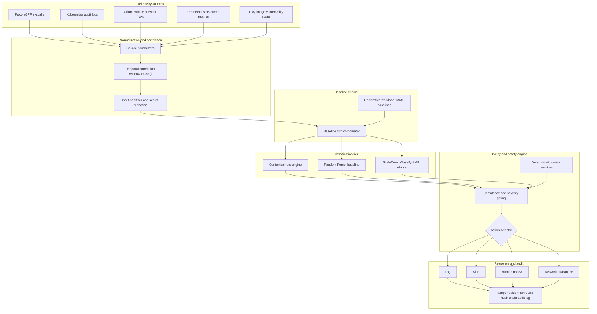

# RuntimeLens

Context-aware runtime and orchestration threat classification for multi-tenant Kubernetes using a typed-decision model.

## Overview

RuntimeLens detects and classifies container security threats in Kubernetes clusters by comparing runtime telemetry against declarative workload baselines. Standard runtime security monitors evaluate syscalls or network flows in isolation, producing alert fatigue and false positives on routine operations. RuntimeLens correlates five telemetry streams, normalizes them into a canonical schema, detects baseline deviations, and evaluates state using heuristic rules, classical machine learning, or a constrained typed-decision model. A deterministic policy engine selects containment actions, recording every decision to an append-only, SHA-256 hash-chained audit trail.

## Architecture



## Core features

- Ingestion across five data sources: Falco syscalls, Kubernetes audit logs, Cilium Hubble network flows, Prometheus resource metrics, and Trivy static image scans.
- Declarative workload baselines defined in YAML profiles tracking permitted binaries, network ports, CPU/memory envelopes, and volume mounts.
- Temporal multi-source correlation engine using a plus-or-minus 30-second window to group events by namespace, pod UID, workload name, and container ID.
- Input sanitizer that strips secrets, tokens, and control characters to prevent prompt injection and credential leakage.
- Deterministic safety overrides that bypass model uncertainty when physical policy violations occur, such as unauthorized host volume mounts.
- Pure policy engine that maps classifications and evidence flags to concrete operational actions: log, alert, human review, or network quarantine.
- Safe network containment using label-based Kubernetes network policies with automatic rollback timers and zero pod deletion permissions.
- Tamper-evident audit logging using an append-only JSONL format with SHA-256 cryptographic hash chaining back to a genesis block.
- Verification CLI harness with built-in doctor checks, webhook daemon controls, event submission, and hash-chain validation.

## Telemetry sources

RuntimeLens unifies signals from five cluster sources:

- Falco: Kernel syscall events captured via modern eBPF probe (file writes, process execution, namespace transitions).
- Kubernetes API audit: Control plane events capturing administrative operations, pod creation, and exec requests.
- Cilium Hubble: Container network flows capturing egress IP destinations, target ports, and dropped packets.
- Prometheus: Resource consumption metrics tracking sustained container CPU and memory usage against workload envelopes.
- Trivy: Image vulnerability reports providing static vulnerability context for deployed containers.

## Threat classes and policy responses

Evaluated threat classes:

- Benign: Routine, expected workload activity matching declared profiles. Action: log.
- Privilege abuse: Unauthorized binaries, unexpected shell sessions, or privilege escalation inside restricted pods. Action: alert or review.
- Container escape: Sensitive host mounts, privileged flag abuse, or container namespace manipulation. Action: quarantine via safety override.
- Cryptomining: Sustained CPU spikes exceeding workload envelopes combined with suspicious outbound egress connections. Action: quarantine.
- Unknown: Degraded telemetry, dropped sensor streams, or conflicting model scores routed to human review. Action: human review.

Available policy actions:

- Log: Record benign events to the audit trail without operator intervention.
- Alert: Notify operators of suspicious activity that does not meet quarantine thresholds.
- Human review: Route low-confidence predictions, sensor drops, or conflicting evidence flags to an operator review queue.
- Quarantine: Apply isolation labels to isolate the target pod with a default-deny network policy and a 15-minute rollback timer. Pods are never deleted.

## Prerequisites

- Python 3.12 or newer
- uv package manager (version 0.11 or newer)
- Optional for live Kubernetes cluster lab: kind, kubectl, and cilium-cli

## Quickstart

Clone the repository and set up the local development environment:

```bash
# Install dependencies into virtual environment via uv
make setup

# Run linter and formatting checks
make lint

# Run strict type checking
make typecheck

# Run test suite
make test
```

## Usage workflows

### Running the demonstration

Run the interactive vertical slice demonstration across benign, privilege abuse, container escape, and cryptomining scenarios:

```bash
make demo
```

To run the demonstration non-interactively in automated mode:

```bash
make demo-auto
```

### Environment diagnostics

Run the doctor command to verify the local Python environment, packages, container engine, and security scanner:

```bash
uv run python scripts/control_runtimelens.py doctor
```

### Webhook ingestion service

Start the local webhook receiver daemon on loopback:

```bash
uv run python scripts/control_runtimelens.py start-webhook \
  --host 127.0.0.1 \
  --port 18765 \
  --audit-file data/audit/webhook_audit.jsonl \
  --secret dev-token-sample \
  --pid-file /tmp/runtimelens-webhook.pid
```

Submit an event payload to the running webhook:

```bash
uv run python scripts/control_runtimelens.py post-event \
  --host 127.0.0.1 \
  --port 18765 \
  --endpoint /falco \
  --secret dev-token-sample \
  --payload '{"output": "Notice: Shell spawned", "rule": "Terminal shell in container", "output_fields": {"k8s.ns.name": "tenant-a", "k8s.pod.name": "web-01", "proc.name": "bash"}}'
```

Stop the background receiver daemon:

```bash
uv run python scripts/control_runtimelens.py stop-webhook \
  --pid-file /tmp/runtimelens-webhook.pid
```

### Verifying audit log integrity

Validate the cryptographic SHA-256 hash chain of any generated audit log:

```bash
uv run python scripts/control_runtimelens.py verify-audit \
  --audit-file data/audit/demo_audit.jsonl
```

## Repository layout

- `src/runtimelens/`: Package implementation containing collectors, normalizers, baselines, classifiers, policy engine, and audit writers.
- `baselines/`: Declarative YAML workload baseline definitions for web, database, api, and payment profiles.
- `scripts/`: Operational tools including the live demo, verification harness CLI, safety linter, and dataset auditor.
- `schemas/`: Canonical event schema specifications.
- `tests/`: Unit, contract, and integration test suites.
- `lab/`: Local kind cluster manifests and Cilium installation configurations.
